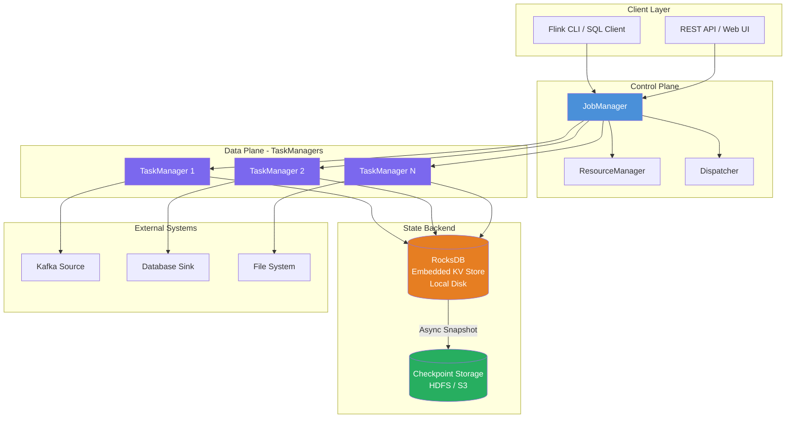
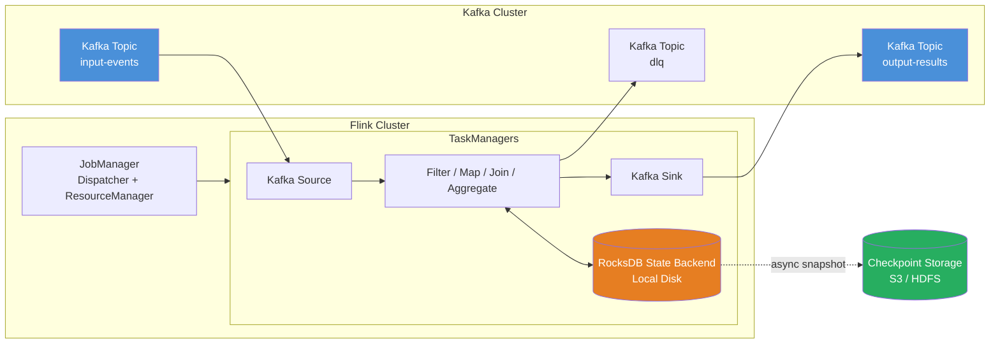

# Apache Flink
[Apache Flink](http://flink.apache.org/)
(formerly known as [Stratosphere](http://stratosphere.eu/)) 
massively parallel & flexible data analytics platform,   
* API: **Java, Scala**, 
* Query Method: **expressive data flows (extended M/R, rich UDFs, iteration support)**, 
* Data Store: **independent** (e.g., HDFS, S3, MongoDB), 
* Written in: Java, License: Apache License V2.0, 
* Misc: **good integration with Hadoop stack** (HDFS, YARN), source code on [Github](https://github.com/apache/flink)

| Area               | Alternatives                                                    |
| ---                | ---                                                             |
| **Sources**        | Pulsar, Kinesis, RabbitMQ, JDBC, filesystem, DataGen, HDFS/S3   |
| **Sinks**          | JDBC, Elasticsearch, Cassandra, Redis, HDFS/S3, Pulsar, Kinesis |
| **Formats**        | Avro, Protobuf, Debezium CDC, Canal, Maxwell, Parquet, ORC      |
| **State backends** | HashMapStateBackend (heap), EmbeddedRocksDBStateBackend         |
| **Deployment**     | Standalone, YARN, native Kubernetes, Flink Kubernetes Operator  |
| **Enrichment**     | Async I/O, broadcast state, JDBC lookup, HTTP lookup            |

> In a [Kafka-centric architecture](#apache-flink--kafka), Flink acts as the stream processing brain: **Kafka in → Flink (filter, transform, join, aggregate, SQL) → Kafka out**, with RocksDB holding state and checkpoints providing exactly-once guarantees.

## 1. Infrastructure Architecture

Apache Flink follows a master-worker architecture. The **JobManager** coordinates distributed execution, while **TaskManagers** execute the actual dataflow tasks. State is stored in a configurable **State Backend** — the recommended production choice is **EmbeddedRocksDBStateBackend**, which stores state on local disk and can exceed memory limits.



### RocksDB as State Backend

The `EmbeddedRocksDBStateBackend` stores all key/value state (including windows) in an embedded RocksDB instance on the TaskManager‘s local disk. This backend can store very large state that exceeds memory and spills to disk, making it suitable for jobs with large state, long windows, and all high-availability setups.

**Key characteristics:**

| Aspect | Detail |
|---|---|
| Storage location | TaskManager local data directories |
| Capacity | Scales to terabytes using disk |
| Checkpointing | Snapshots RocksDB database; supports incremental checkpoints |
| Trade-off | Access/update involves serialization/deserialization (higher overhead than heap-based) |
| Best for | Large state, long windows, HA setups |

**Configuration (flink-conf.yaml):**
```yaml
state.backend: rocksdb
state.backend.incremental: "true"
state.checkpoints.dir: s3://flink-state/checkpoints/
state.backend.rocksdb.memory.managed: "true"
```


**Programmatic setup:**
```java
env.setStateBackend(new EmbeddedRocksDBStateBackend(true));
// or with checkpoint path
env.setStateBackend(new RocksDBStateBackend(
    "hdfs://namenode:40010/flink/checkpoints", true
));
```

# Apache Flink + Kafka 

> **Focus:** Kafka as the primary source/sink and collaboration point.  
> Other connectors and deployment modes are mentioned only briefly at the end.

---

## 1. Infrastructure Architecture (Kafka-Centric)

Flink runs as a **JobManager** (control plane) + **TaskManagers** (data plane).  
For Kafka pipelines, state is usually large and long-lived, so the recommended state backend is **EmbeddedRocksDBStateBackend** — state lives on TaskManager local disk, spills beyond memory, and is snapshotted to durable storage during checkpoints.



**RocksDB configuration:**

```yaml
state.backend: rocksdb
state.backend.incremental: "true"
state.backend.rocksdb.memory.managed: "true"
state.checkpoints.dir: s3://flink-state/checkpoints/
```

```java
env.setStateBackend(new EmbeddedRocksDBStateBackend(true));
```

---

## 2. Kafka Collaboration Core

### 2.1 Kafka Source

**DataStream API:**

```java
KafkaSource<String> source = KafkaSource.<String>builder()
    .setBootstrapServers("kafka:9092")
    .setTopics("input-events")
    .setGroupId("flink-group")
    .setStartingOffsets(OffsetsInitializer.committedOffsets(OffsetResetStrategy.EARLIEST))
    .setValueOnlyDeserializer(new SimpleStringSchema())
    .build();

DataStream<String> stream = env.fromSource(
    source,
    WatermarkStrategy.<String>forBoundedOutOfOrderness(Duration.ofSeconds(5))
        .withTimestampAssigner((event, ts) -> extractTimestamp(event)),
    "Kafka Source"
);
```

**Flink SQL DDL:**

```sql
CREATE TABLE kafka_events (
    user_id BIGINT,
    event_type STRING,
    page STRING,
    event_time TIMESTAMP(3),
    WATERMARK FOR event_time AS event_time - INTERVAL '5' SECOND
) WITH (
    'connector' = 'kafka',
    'topic' = 'input-events',
    'properties.bootstrap.servers' = 'kafka:9092',
    'properties.group.id' = 'flink-sql-group',
    'scan.startup.mode' = 'group-offsets',
    'format' = 'json'
);
```

### 2.2 Kafka Sink

**DataStream API — exactly-once:**

```java
KafkaSink<String> sink = KafkaSink.<String>builder()
    .setBootstrapServers("kafka:9092")
    .setRecordSerializer(KafkaRecordSerializationSchema.builder()
        .setTopic("output-results")
        .setValueSerializationSchema(new SimpleStringSchema())
        .build())
    .setDeliveryGuarantee(DeliveryGuarantee.EXACTLY_ONCE)
    .setTransactionalIdPrefix("flink-sink-")
    .build();

stream.sinkTo(sink);
```

**Flink SQL sink:**

```sql
CREATE TABLE kafka_sink (
    page STRING,
    window_end TIMESTAMP(3),
    view_count BIGINT
) WITH (
    'connector' = 'kafka',
    'topic' = 'output-results',
    'properties.bootstrap.servers' = 'kafka:9092',
    'format' = 'json'
);
```

**Upsert Kafka sink** — use when you have a primary key and want changelog semantics:

```sql
CREATE TABLE kafka_upsert (
    user_id BIGINT,
    total BIGINT,
    PRIMARY KEY (user_id) NOT ENFORCED
) WITH (
    'connector' = 'upsert-kafka',
    'topic' = 'user-totals',
    'properties.bootstrap.servers' = 'kafka:9092',
    'key.format' = 'json',
    'value.format' = 'json'
);
```

### 2.3 Exactly-Once Checklist

| Requirement             | Setting                                      |
| ---                     | ---                                          |
| Checkpointing enabled   | `execution.checkpointing.interval: 60s`      |
| Checkpoint mode         | `execution.checkpointing.mode: EXACTLY_ONCE` |
| Kafka sink guarantee    | `sink.delivery-guarantee = exactly-once`     |
| Transactional ID prefix | `sink.transactional-id-prefix = flink-sink-` |
| State backend           | `state.backend: rocksdb`                     |
| Checkpoint storage      | `state.checkpoints.dir: s3://...`            |

### 2.4 Parallelism & Partitions

- Flink Kafka source parallelism can match Kafka partition count.
- One Kafka partition is read by exactly one Flink source subtask.
- Per-partition ordering is preserved; global ordering is not guaranteed.
- Watermarks are generated per subtask and merged downstream.

---

## 3. Operations with Kafka Streams

### 3.1 Filter

**DataStream API:**

```java
DataStream<String> filtered = stream
    .filter(event -> event.contains("purchase"));
```

**Flink SQL:**

```sql
INSERT INTO kafka_sink
SELECT page, window_end, view_count
FROM kafka_events
WHERE event_type = 'purchase';
```

> Other filter sources: filesystem, JDBC, Pulsar — same operators apply.

### 3.2 Transform / Enrich

**Map / flatMap:**

```java
DataStream<PageView> enriched = stream
    .map(json -> parsePageView(json))
    .flatMap((PageView pv, Collector<PageView> out) -> {
        if (pv.page != null) out.collect(pv);
    });
```

**SQL projection / derived columns:**

```sql
SELECT
    user_id,
    UPPER(page) AS page_upper,
    event_time,
    event_time + INTERVAL '1' HOUR AS event_time_plus_1h
FROM kafka_events;
```

**Lookup enrichment** — enrich Kafka stream with an external dimension table:

```sql
CREATE TABLE users (
    user_id BIGINT,
    country STRING,
    PRIMARY KEY (user_id) NOT ENFORCED
) WITH (
    'connector' = 'jdbc',
    'url' = 'jdbc:postgresql://postgres:5432/app',
    'table-name' = 'users'
);

SELECT e.user_id, e.page, u.country
FROM kafka_events AS e
JOIN users FOR SYSTEM_TIME AS OF e.proc_time AS u
ON e.user_id = u.user_id;
```

> Other enrichment options: async I/O with Redis/HTTP, broadcast state, JDBC lookup. Kafka remains the main stream.

### 3.3 Join

**Kafka–Kafka interval join:**

```sql
SELECT o.order_id, o.amount, s.status
FROM orders AS o
JOIN shipments AS s
ON o.order_id = s.order_id
AND o.order_time BETWEEN s.ship_time - INTERVAL '5' MINUTE
                     AND s.ship_time + INTERVAL '5' MINUTE;
```

**Kafka–Kafka regular join:**

```sql
SELECT o.order_id, o.amount, s.status
FROM orders AS o
JOIN shipments AS s
ON o.order_id = s.order_id;
```

> Regular joins keep state in RocksDB. Without time bounds, state grows forever — prefer interval joins or window joins for unbounded Kafka streams.

**Temporal join** — requires a primary key and rowtime attribute on the versioned table:

```sql
SELECT o.order_id, o.product_id, p.unit_price
FROM orders AS o
JOIN product_versions FOR SYSTEM_TIME AS OF o.proc_time AS p
ON o.product_id = p.product_id;
```

> Without a primary key, avoid temporal joins. Use interval joins, window joins, or enrich via an external lookup table instead.

### 3.4 Aggregate

**Windowed aggregation in SQL:**

```sql
SELECT
    page,
    window_end,
    COUNT(*) AS view_count
FROM TABLE(
    TUMBLE(TABLE kafka_events, DESCRIPTOR(event_time), INTERVAL '1' MINUTE)
)
GROUP BY page, window_start, window_end;
```

**Grouped aggregation in SQL:**

```sql
SELECT user_id, COUNT(*) AS event_count
FROM kafka_events
GROUP BY user_id;
```

**DataStream API keyed window:**

```java
stream
    .keyBy(event -> event.userId)
    .window(TumblingEventTimeWindows.of(Time.minutes(1)))
    .aggregate(new CountAggregate())
    .sinkTo(kafkaSink);
```

> RocksDB holds window and keyed state. Incremental checkpoints keep snapshots efficient.

---

## 4. Flink SQL with Kafka

Flink SQL treats Kafka topics as tables. Queries are **continuous** and emit results as new Kafka records arrive.

### 4.1 Source Table with Watermark

```sql
CREATE TABLE kafka_events (
    user_id BIGINT,
    event_type STRING,
    page STRING,
    event_time TIMESTAMP(3),
    WATERMARK FOR event_time AS event_time - INTERVAL '5' SECOND
) WITH (
    'connector' = 'kafka',
    'topic' = 'input-events',
    'properties.bootstrap.servers' = 'kafka:9092',
    'properties.group.id' = 'flink-sql-group',
    'scan.startup.mode' = 'group-offsets',
    'format' = 'json'
);
```

### 4.2 Sink Table

```sql
CREATE TABLE kafka_sink (
    page STRING,
    window_end TIMESTAMP(3),
    view_count BIGINT
) WITH (
    'connector' = 'kafka',
    'topic' = 'output-results',
    'properties.bootstrap.servers' = 'kafka:9092',
    'format' = 'json'
);
```

### 4.3 Continuous Query

```sql
INSERT INTO kafka_sink
SELECT
    page,
    window_end,
    COUNT(*) AS view_count
FROM TABLE(
    TUMBLE(TABLE kafka_events, DESCRIPTOR(event_time), INTERVAL '1' MINUTE)
)
GROUP BY page, window_start, window_end;
```

### 4.4 Common Kafka Connector Options

| Option                         | Description                                                      |
| ---                            | ---                                                              |
| `connector`                    | `kafka` or `upsert-kafka`                                        |
| `topic`                        | Kafka topic name                                                 |
| `properties.bootstrap.servers` | Kafka brokers                                                    |
| `properties.group.id`          | Consumer group                                                   |
| `scan.startup.mode`            | `earliest-offset`, `latest-offset`, `group-offsets`, `timestamp` |
| `format`                       | `json`, `avro`, `debezium-json`, `canal-json`, etc.              |
| `sink.partitioner`             | `default`, `fixed`, `round-robin`                                |
| `sink.delivery-guarantee`      | `none`, `at-least-once`, `exactly-once`                          |
| `sink.transactional-id-prefix` | Prefix for Kafka transactions                                    |

> Other formats/systems: Avro + Schema Registry, Debezium CDC, JDBC, Elasticsearch, Pulsar, Kinesis, filesystem, HDFS/S3. Kafka remains the primary backbone.

---

## 5. Deploy Flink with Kubernetes Operator (Kafka Pipeline)

### 5.1 Install Operator

```bash
helm repo add flink-operator-repo \
  https://downloads.apache.org/flink/flink-kubernetes-operator-1.8.0/

helm install flink-kubernetes-operator \
  flink-operator-repo/flink-kubernetes-operator \
  --namespace flink --create-namespace
```

> If webhooks are enabled, install **cert-manager** first.

### 5.2 FlinkDeployment for Kafka Job

```yaml
apiVersion: flink.apache.org/v1beta1
kind: FlinkDeployment
metadata:
  name: kafka-order-processor
spec:
  image: myregistry/flink-kafka-processor:v1.0.0
  flinkVersion: v1_18
  flinkConfiguration:
    # Checkpointing + exactly-once
    execution.checkpointing.interval: "60s"
    execution.checkpointing.mode: EXACTLY_ONCE
    execution.checkpointing.min-pause: "30s"
    execution.checkpointing.timeout: "5min"
    state.checkpoints.num-retained: "5"

    # RocksDB state backend
    state.backend: rocksdb
    state.backend.incremental: "true"
    state.backend.rocksdb.memory.managed: "true"

    # Durable storage
    state.checkpoints.dir: s3://flink-state/checkpoints/kafka-order-processor/
    state.savepoints.dir: s3://flink-state/savepoints/kafka-order-processor/

    # Kafka sink exactly-once
    sink.delivery-guarantee: exactly-once
    sink.transactional-id-prefix: flink-kafka-order-
  jobManager:
    resource:
      memory: "2048m"
      cpu: 1
  taskManager:
    resource:
      memory: "4096m"
      cpu: 2
    replicas: 3
  job:
    jarURI: local:///opt/flink/usrlib/kafka-order-processor.jar
    parallelism: 3
    upgradeMode: savepoint
    state: running
```

### 5.3 Apply & Manage

```bash
kubectl apply -f kafka-order-processor.yaml

kubectl get flinkdeployments

# Trigger savepoint before upgrade
kubectl patch flinkdeployment kafka-order-processor \
  --type merge -p '{"spec":{"job":{"savepointTriggerNonce":1}}}'
```

---

## 6. Proper Time Order Without Primary Key

Kafka streams often have no primary key. Flink can still enforce event-time ordering using **watermarks**.

### 6.1 Use Kafka Record Timestamp as Event Time

```sql
CREATE TABLE kafka_events (
    user_id BIGINT,
    page STRING,
    event_time TIMESTAMP(3) METADATA FROM 'timestamp',
    WATERMARK FOR event_time AS event_time - INTERVAL '5' SECOND
) WITH (
    'connector' = 'kafka',
    'topic' = 'input-events',
    'properties.bootstrap.servers' = 'kafka:9092',
    'format' = 'json'
);
```

### 6.2 Watermark Strategies

```java
// Tolerate out-of-order events up to 5 seconds
WatermarkStrategy.<Event>forBoundedOutOfOrderness(Duration.ofSeconds(5))
    .withTimestampAssigner((event, ts) -> event.getTimestamp());

// Assume per-partition order is strictly increasing
WatermarkStrategy.<Event>forMonotonousTimestamps()
    .withTimestampAssigner((event, ts) -> event.getTimestamp());
```

### 6.3 Without a Primary Key

| Need                                   | Recommended Approach                                           |
| ---                                    | ---                                                            |
| Ordered processing per Kafka partition | Event-time + watermarks                                        |
| Global time order across partitions    | Not guaranteed; use watermarks with idleness                   |
| Joins without PK                       | Interval join or window join                                   |
| Aggregations without PK                | Windowed `GROUP BY` on event-time attribute                    |
| Sink without PK                        | Use regular `kafka` sink (append mode), **not** `upsert-kafka` |
| Temporal join without PK               | Avoid; use lookup enrichment or interval join instead          |

**Key rule:**  
Kafka gives per-partition order. Flink watermarks give deterministic event-time semantics across partitions. Without a primary key, prefer **append-only Kafka sinks** and **interval/window operations** rather than upsert or temporal joins.

