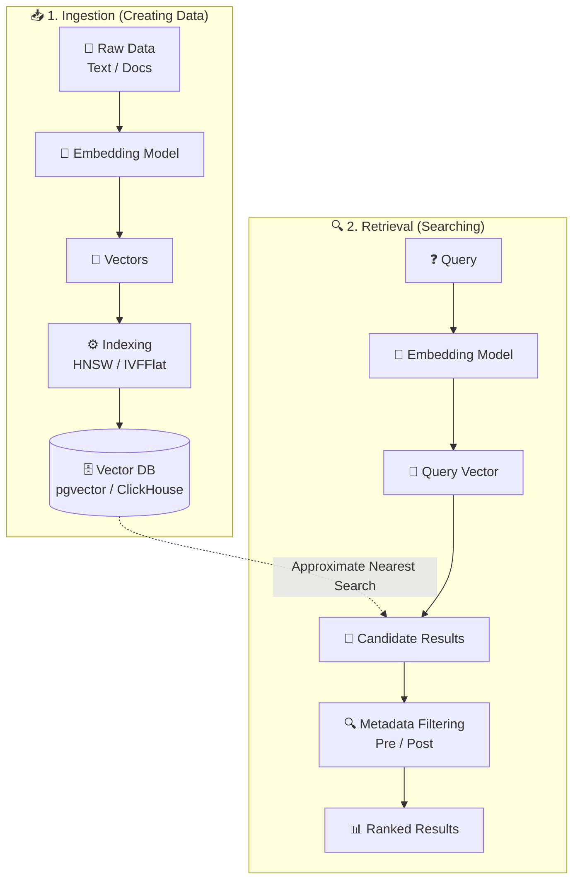

# Vector DB 
> What is a Vector DB?
Imagine you have thousands of photos or text docs. A computer can't "read" them like we do, so it turns them into
Vectors (long lists of numbers) using an Embedding Model.
 * Input: Text, Images, Audio.
 * Embedding: The process of turning input into a vector.
 * Vector DB: A specialized database that stores these numbers and lets you search for "similar" things (Nearest Neighbor Search).

## Tools
* [CLI for Weaviate, Milvus, Chroma, Qdrant, and other vector DBs](https://github.com/maximilien/weave-cli)

## Links
* [vector DB comparison](https://superlinked.com/vector-db-comparison)
  * [cosine simularity](https://en.wikipedia.org/wiki/Cosine_similarity)

##  pgvector vs. Dedicated Vector DB
┌─────────────┬─────────────────────────────────────────────────────┬────────────────────────────────────┐
│ Feature     │ pgvector (Postgres)                                 │ Dedicated Vector DB (Pinecone,     │
│             │                                                     │ Milvus)                            │
├─────────────┼─────────────────────────────────────────────────────┼────────────────────────────────────┤
│ Best For    │ Small to Medium scale (~10M vectors).               │ Massive scale (Billions of         │
│             │                                                     │ vectors).                          │
│ Ease of Use │ Great if you already use Postgres. No new tech.     │ New system to learn and maintain.  │
│ Hybrid      │ Best: Combine SQL (where id=123) + Vector.          │ Harder: Must sync data between two │
│ Search      │                                                     │ DBs.                               │
│ Speed       │ Good, but can slow down under heavy load.           │ Extremely fast (optimized for just │
│             │                                                     │ vectors).                          │
│ ClickHouse  │ Note from image: High-speed analytical DB that also │                                    │
│             │ supports vectors.                                   │                                    │
└─────────────┴─────────────────────────────────────────────────────┴────────────────────────────────────┘

## 🗺️ The Two-Phase Architecture

The "Embedding Model"
1. **The Translator:** The Embedding Model (like OpenAI's `text-embedding-3-small`, Cohere, or open-source models like BGE) acts as a translator. It takes your **Raw Data** (Step 1: words, documents, images) and converts it into a **Vector** (Step 3: a long list of numbers).
2. **Capturing Meaning:** It doesn't just assign random numbers; it maps the data into a multi-dimensional space where similar concepts are physically close together. (e.g., "dog" and "puppy" will have very similar number arrays).
3. **The Dependency:** You cannot create the vectors without the model. The pipeline is literal: **Raw Data \(\rightarrow\) [Passes through] \(\rightarrow\) Embedding Model \(\rightarrow\) [Outputs] \(\rightarrow\) Vectors**.

**A quick analogy:**
*   **Raw Data** = A book written in French.
*   **Embedding Model** = A translator.
*   **Vectors** = The English translation (which the computer can now read and index).

---

### 📥 Phase 1: Ingestion (Creating Data)

| Component | What it is | 🔗 Link |
| :--- | :--- | :--- |
| **Embeddings** | Translating raw data (text/images) into numerical vectors. | [OpenAI Embeddings Guide](https://platform.openai.com/docs/guides/embeddings) |
| **PostgreSQL** | Robust open-source relational database. | [PostgreSQL Docs](https://www.postgresql.org/docs/) |
| **pgvector** | Extension for PostgreSQL adding vector similarity search. | [pgvector GitHub](https://github.com/pgvector/pgvector) |
| **ClickHouse** | High-performance columnar DB with built-in vector search. | [ClickHouse Vector Search](https://clickhouse.com/docs/en/resources/support-center/knowledge-base/general-faqs/vector-search) |

---

### 🔍 Phase 2: Retrieval (Searching)

| Component | What it is | 🔗 Link |
| :--- | :--- | :--- |
| **Approximate Nearest Search (ANN)** | Search strategy that trades slight accuracy for massive speed gains. | [ANN Explained](https://learn.microsoft.com/en-us/training/modules/implement-vector-search-azure-database-postgresql/3-perform-fast-vector-similarity-search) |

## Indexing Algorithms
*How vectors are organized for fast retrieval.*

| Algorithm                                        | ⚡ Mechanism                                                 | 🎯 Best For                       | 🔗 Link                                                                                                                                       |
| :---                                             | :---                                                        | :---                              | :---                                                                                                                                          |
| **HNSW** (Hierarchical Navigable Small World) | Graph-based, multi-layered structure for fast traversal.    | High recall & fast queries.       | [HNSW Overview](https://docs.oracle.com/en/database/oracle/oracle-database/26/vecse/overview-hierarchical-navigable-small-world-indexes.html) |
| **IVFFlat** (Inverted File Flat)              | Clusters vectors into lists; searches only nearby clusters. | Faster build time & lower memory. | [IVFFlat Guide](https://supabase.com/docs/guides/ai/vector-indexes/ivf-indexes)                                                               |

* HNSW (Hierarchical Navigable Small World)
   * The "Luxury" choice.
   * How it works: Creates a "web" of points. It jumps between far-apart points to get close, then zooms in.
   * Pros: Super fast search, high accuracy, handles new data easily.
   * Cons: Uses a lot of RAM (Memory).
* IVFFlat (Inverted File Flat)
   * The "Budget" choice.
   * How it works: Groups vectors into "buckets" (clusters). It finds the right bucket and only searches inside it.
   * Pros: Low memory usage, fast to set up.
   * Cons: Accuracy can drop if you add too much new data without rebuilding the index.

## Metadata Filtering: Pre vs. Post
If you want to search for "Shoes" (Vector) that are "Red" (Metadata):
* Pre-filtering (The Right Way):
   1. Find all Red items first.
   2. Search for the most similar Shoes within that red list.
   * Result: You always get exactly what you asked for.
* Post-filtering (The Fast but Risky Way):
   1. Find the 10 most similar Shoes first.
   2. Remove any that aren't Red.
   * Result: You might end up with only 1 or 2 results (or zero!) because the best matches weren't red.

*Combining vector search with traditional SQL-like filters.*
| Filter Type          | ⚙️ Mechanism                                           | ⚖️ Trade-off                                                               | 🔗 Link                                                                                          |
| :---                 | :---                                                   | :---                                                                       | :---                                                                                             |
| **✅ Pre-filtering**  | Applies metadata filter **before** vector search.      | Fast; avoids scanning irrelevant vectors.                                  | [Pre-filtering Docs](https://docs.lancedb.com/search/filtering)                                  |
| **⏳ Post-filtering** | Runs vector search **first**, then applies the filter. | Simpler logic; but may return empty results if top candidates don't match. | [Post-filtering vs Pre-filtering](https://qdrant.tech/articles/pre-filtering-vs-post-filtering/) |

## 📊 Performance Trade-offs: Dimensions
 * Dimension: The "length" of the vector (e.g., 1536 numbers).
 * Memory: Higher dimensions = More RAM needed.
 * Speed: Higher dimensions = More math = Slower queries.
 * Pro Tip: Finding the balance between "high detail" (high dimensions) and "low cost" (low dimensions) is the
   key to a good Vector DB setup.

*Directional impact: How vector size affects your system.*
*   **⬆️ Higher Dimensions** \(\rightarrow\) 🧠 **Memory** (increases) & 🐢 **Speed** (slower query).
*   **⬇️ Lower Dimensions** \(\rightarrow\) ⚡ **Speed** (faster) & 📉 **Accuracy** (risk of losing nuance).